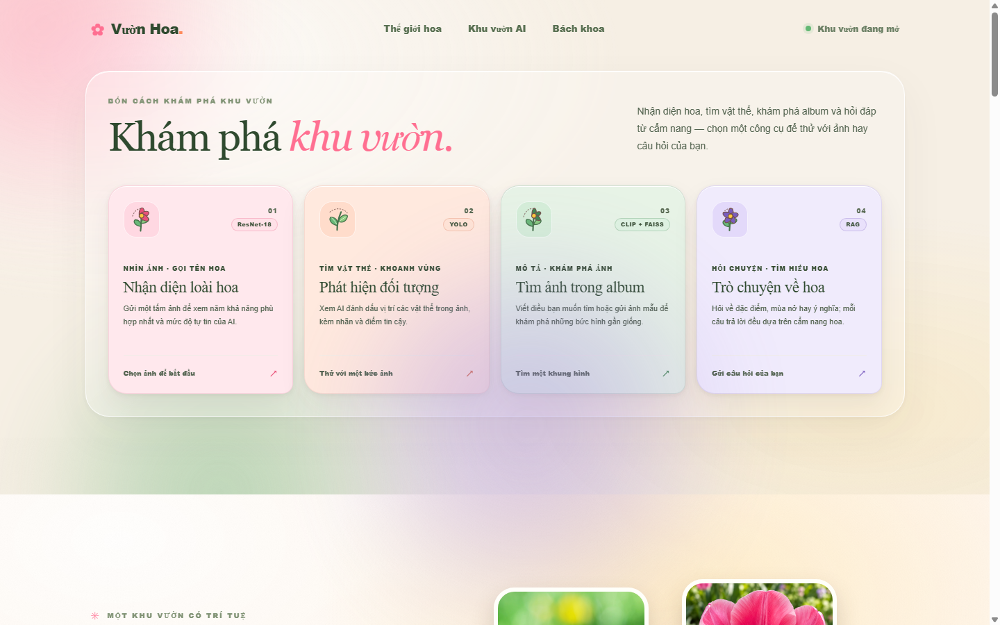
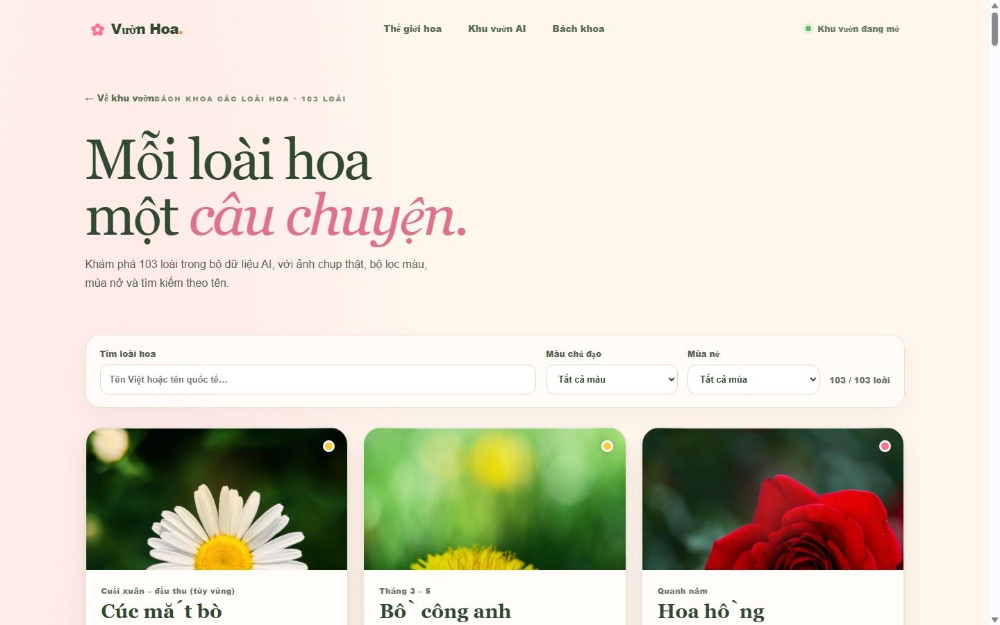
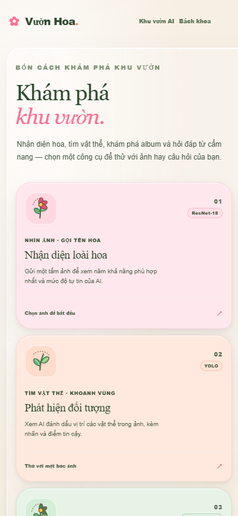

# TKWNC_nhom10 — Vườn Hoa AI

**Demo trực tiếp:** https://tkwnc-nhom10.vercel.app/  
**Backend Render:** https://tkw-nhom10-api.onrender.com
**Health check:** https://tkw-nhom10-api.onrender.com/api/health  
**Cloud Run:** chưa triển khai; hiện chỉ dùng lựa chọn miễn phí và không bật billing Google Cloud.

## Trạng thái kiểm tra (22/10/2026)

- Backend Render đang live ở revision `a5054d417f9f` (deploy `dep-dbd3dceq1p3s73dq89lg`); frontend production: `https://tkwnc-nhom10.vercel.app/`. Cả ba CI checks của commit đều xanh: `pytest`, `web-build-and-tests`, Vercel Preview Comments. Backend local: **104 passed, 1 skipped**; PostgreSQL integration test được chạy trong CI với PostgreSQL 16.
- Bốn API AI đều đã trả HTTP 200 trên production: phân loại, phát hiện, tìm ảnh, chatbot RAG. Gemini trả HTTP 200 trong lần gọi RAG gần nhất. Render Free có thể mất thêm thời gian khi khởi động nguội; detector/chat từng mất khoảng 48/47 giây trong smoke test, nên đây là giới hạn hiệu năng của gói miễn phí chứ không phải benchmark ổn định.
- Tìm kiếm ảnh: ảnh hướng dương chưa có trong gallery trả về 5/5 ảnh hướng dương trên production. Benchmark ResNet-feature hiện tại đạt Precision@5 **91,65%** trên 206 truy vấn held-out theo đường dẫn, nhưng các ảnh vẫn đến từ cùng nguồn dữ liệu Flowers, vì vậy chưa chứng minh tổng quát với ảnh tự chụp ngoài bộ dữ liệu.
- Tìm kiếm bằng mô tả tiếng Việt: 10/10 câu development thủ công trả đúng loài và 5/5 ảnh đúng trong smoke test production. Đây là bộ câu nhỏ do nhóm viết, chưa phải đánh giá độc lập hay đại diện cho toàn bộ 103 loài.
- Xác thực/CSDL public đã thử qua cùng origin Vercel: login, `/api/auth/me`, đọc hai bộ dữ liệu mẫu và logout đều HTTP 200; dữ liệu demo được ghi/đọc từ Neon PostgreSQL Free ở Singapore qua `DATABASE_URL`. Giá trị bí mật không nằm trong Git.
- Tài khoản demo để chấm: `demo@vuonhoa.example.com` / `VuonHoa-Demo-2026!`. Đây là tài khoản dùng chung với dữ liệu mẫu, không lưu thông tin cá nhân. Bằng chứng smoke không chứa mật khẩu/cookie tại [`reports/current-production-demo-account-smoke.json`](reports/current-production-demo-account-smoke.json).
- Toàn bộ hạ tầng đang dùng gói miễn phí; chưa bật billing Google Cloud hoặc dịch vụ trả phí. SQLite chỉ dùng local/Compose; Neon Free tự scale compute về 0 khi nhàn rỗi.

Website tra cứu 103 loài hoa trong bộ dữ liệu nhận diện, với bốn chức năng AI lấy từ notebook môn học: phân loại ảnh, phát hiện đối tượng, tìm kiếm ảnh bằng chữ hoặc ảnh, và chatbot RAG tiếng Việt. ResNet-18 có 103 nhãn; trang chủ chọn 5 loài làm câu chuyện nổi bật, còn Bách khoa và trang chi tiết bao phủ toàn bộ 103 loài.

## Kiến trúc

- `core/`: suy luận dùng chung — ResNet-18 (103 nhãn), YOLO11, tìm ảnh production bằng embedding ResNet 512 chiều + lọc loài theo dự đoán, và Gemini + RAG BM25 (có thể chọn Qwen local). MobileCLIP2 còn trong đường chạy thử/Streamlit nhưng không phải backend retrieval của Render Free.
- `api/main.py`: FastAPI cung cấp REST API cho các endpoint AI và giao diện Streamlit; trên Render Free model nặng được nạp theo yêu cầu để giữ trong giới hạn RAM. `/api/health` trả trạng thái nạp thực tế từng model.
- `api/gateway.js`: Express cung cấp API đăng ký/đăng nhập và lưu Sổ hoa/Cây của tôi vào PostgreSQL khi Vercel có `DATABASE_URL`. Trong lúc chưa cấu hình biến này, gateway chuyển tiếp các route tài khoản về FastAPI trên Render để luồng production hiện tại tiếp tục hoạt động. Local/Compose vẫn dùng FastAPI cùng SQLite hoặc PostgreSQL theo `DATABASE_URL`. Mật khẩu băm bằng scrypt tương thích giữa hai backend; session dùng cookie `HttpOnly`.
- Lỗi HTTP, validation và lỗi server ngoài dự kiến được chuẩn hoá tập trung ở API; phản hồi validation không lặp lại giá trị input và lỗi 500 không trả chi tiết nội bộ.
- `web/`: React + Vite, trải nghiệm responsive theo chủ đề vườn hoa.
- `data/kb/`: tám bản tóm tắt tiếng Việt cùng PDF được chia theo trang; danh mục, số trang và phạm vi nguồn xem tại [`data/kb_sources.md`](data/kb_sources.md).
- `data/kb_eval/rag_hit_at_3.json`: 30 câu hỏi đánh giá nguồn RAG. `python scripts/evaluate_rag.py` đo Hit@3 và kiểm tra câu trả lời fallback có dẫn tệp nguồn mong đợi; lượt gần nhất đạt 30/30 ở cả hai phép đo. Sáu câu hồi quy riêng kiểm tra một số sự kiện và nguồn cụ thể để tránh fallback trích sai ý; các mẫu này không phải evaluator bao phủ toàn bộ độ đúng của câu trả lời. Bộ câu hỏi do nhóm biên soạn; phép đo citation không xác nhận tính đúng, đầy đủ hay chất lượng diễn đạt.
- `data/species.json`: dữ liệu của 103 loài, khớp với 103 nhãn trong `artifacts/classifier/classes.json`.
- `data/display_images.json`: nguồn ảnh trưng bày chất lượng cao cho 5 loài nổi bật trên trang chủ; các loài còn lại dùng ảnh đại diện trong dữ liệu Flowers.
- `data/flower_params.json`: tham số hình học cho 103 loài ở trình xem 3D; 90 loài có mô hình thủ tục và 13 loài hình thái phức tạp ưu tiên ảnh thật. Quy trình sinh, nguồn gợi ý và trang contact sheet duyệt được mô tả tại [`docs/flower-models-103.md`](docs/flower-models-103.md).
- `data/gift_meanings.json`: dữ liệu gợi ý tặng hoa cho 28 ứng viên phổ biến; 75 loài còn lại chỉ giữ ý nghĩa chung. Mọi ánh xạ dịp/người nhận hiện `verified=false`.
- `web/public/images/gift-flowers/`: ảnh đại diện cục bộ của 28 ứng viên; không phụ thuộc backend để hiển thị bó.
- `/tang-hoa`: gợi ý ba bó theo quy tắc (không gọi model), lời nhắn qua chatbot Gemini hiện có với mẫu offline dự phòng, thiệp PNG/QR và Sổ hoa lưu trong trình duyệt. API luật: `POST /api/gifts/recommend`.
- Trong hộp thoại **Bác sĩ hoa**, tab **Cây của tôi** lưu danh sách cây đang trồng, chu kỳ chăm do người dùng tự đặt, ghi nhận đã chăm và dự báo mưa theo vị trí khi người dùng chủ động cấp quyền. Dữ liệu hoạt động offline trong `localStorage`; khi đăng nhập, Sổ hoa và danh sách cây được đồng bộ qua API vào SQLite local/Compose hoặc PostgreSQL trên Render. Thông báo chăm sóc cần quyền trình duyệt và hộp thoại Bác sĩ hoa đang mở. Dự báo dùng [Open-Meteo](https://open-meteo.com/), không tự thay đổi lịch chăm.
- `data/kb/y_nghia_tang_hoa.md`: ghi chú RAG và nguồn bối cảnh văn hoá. Chưa có nguồn nào trong đó xác minh từng ánh xạ loài–dịp–người nhận; dữ liệu vẫn là bản nháp.

### Tặng hoa và Sổ hoa

Trang Tặng hoa phối gợi ý từ dịp, người nhận, màu và quy mô (5/9/15 cành; không hiển thị giá). Kết quả hiển thị hoa chính, hoa phụ, lá trang trí, ý nghĩa chung, lý do chấm điểm, màu và lưu ý. Mở trang từ kết quả nhận diện sẽ giữ loài vừa nhận diện làm hoa chính nếu loài đó có dữ liệu phù hợp với dịp đã chọn. Đây là **hệ thống quy tắc/dữ liệu**, không phải chức năng AI. `verified=false` nghĩa là ánh xạ dịp/người nhận và lưu ý văn hoá chưa được duyệt. Repo có nguồn bối cảnh văn hoá tổng quát, nhưng chưa có nguồn xác minh từng ánh xạ cụ thể. Đặc biệt, gợi ý cho chia buồn/thờ cúng cần hỏi phong tục gia đình và vùng miền.

Lời nhắn gọi `/api/chat/sync` (provider Gemini theo cấu hình backend hiện tại), cache trên trình duyệt theo bó/người nhận/dịp và dùng mẫu offline nếu API lỗi. Người dùng có thể tải ảnh thiệp PNG hoặc tạo mã QR. QR mã hoá lời nhắn vào fragment URL của chính site, không gọi dịch vụ QR bên thứ ba; người nhận mở trang thiệp, xem ảnh hoa/lời nhắn và có đường dẫn tới Bách khoa hoặc mô hình 3D. Vì lời nhắn nằm trong URL, chỉ chia sẻ cho người nhận mong muốn. Trên localhost QR chỉ mở localhost; để người khác quét, hãy tạo mã từ bản site có URL công khai. Sổ hoa và tab **Cây của tôi** giữ bản offline trong `localStorage`; khi đăng nhập, ứng dụng đồng bộ qua API vào SQLite ở local/Compose hoặc Neon PostgreSQL trên production Render. Dữ liệu local được phân biệt theo tài khoản trên cùng trình duyệt; khi logout, dữ liệu vẫn được giữ trên thiết bị. Chu kỳ do người dùng tự chọn, không phải khuyến nghị nông học; cần kiểm tra đất, điều kiện trồng và nhãn phân bón. Nhắc việc không phải push notification nền: thông báo chỉ phát khi trang đang chạy và quyền trình duyệt đã cấp. Dự báo mưa dùng dữ liệu Open-Meteo sau thao tác chủ động lấy vị trí; vị trí không được lưu lại, dự báo chỉ mang tính tham khảo và không thay thế kiểm tra đất tại chậu. Xoá hoa khỏi Sổ hoa không xoá cây trong tab **Cây của tôi**.

### Tối ưu tải giao diện (13/10/2026)

- Năm ảnh trưng bày được chuyển sang WebP, giữ nguyên độ phân giải và đã kiểm tra trực quan. Tổng dung lượng của bộ ảnh giảm từ **3.361.123 byte** xuống **547.280 byte** (giảm **83,7%**); ảnh gốc không còn được phục vụ trùng lặp.
- Bốn panel AI được tải khi người dùng mở panel; lần đầu mở có trạng thái chờ tải module.
- Google Fonts được preload bất đồng bộ để stylesheet font không chặn dựng trang.
- Lighthouse mobile đo trên bản production đang public ghi nhận payload **3,678 MiB**, điểm Performance dao động **61–67** trong hai lượt, Accessibility **100**, Best Practices **100**, SEO **92**. Bản build mới tại localhost ghi payload **1,125 MiB**, Performance **60**, Accessibility **100**, Best Practices **96**, SEO **92**. Hai lượt dùng hai môi trường khác nhau nên không xem là phép so sánh trước/sau; branch preview hiện bị Vercel SSO bảo vệ, chưa đo lại được cùng môi trường. Chưa tuyên bố đạt cải thiện điểm Lighthouse.

## Ảnh giao diện

Ảnh chụp giao diện local ở kích thước 1440 × 900; ảnh minh họa giao diện, không giả lập kết quả inference production.







## Cần cài

- Python 3.11
- Node.js 20.19 trở lên
- Kết nối Internet lần đầu để tải Flowers và trọng số mô hình
- GPU giúp khởi tạo nhanh hơn; CPU vẫn chạy được nhưng thời gian chuẩn bị/inference lâu hơn

## Chạy nhanh cả giao diện và API trên Windows

**Một lệnh với Docker:** cần Docker Desktop đang chạy và các checkpoint cần thiết đã có trong repo/Git LFS. Mở terminal tại thư mục gốc:

```powershell
docker compose -f compose.yaml up --build
```

Mở `http://localhost:7860`. Docker volume `vuonhoa-data` giữ CSDL SQLite qua lần khởi động lại container. Cấu hình này dùng truy xuất ảnh dựa trên đặc trưng classifier và chỉ giữ model nặng cần cho request hiện tại để giảm RAM; tìm ảnh bằng câu chữ vẫn hoạt động. Đã smoke-test Compose ngày 22/10/2026: `/api/health`, `/api/classify`, `/api/detect`, `/api/search/text`, `/api/chat/sync` đều trả 200; `/api/auth/register` trả 201; ghi/đọc dữ liệu tài khoản trả 200 và dữ liệu còn sau hai lần restart container. Thời gian đo trong container ở lượt xác minh gần nhất: classify 3,43 giây, detect 0,54 giây, search 0,41 giây, chat RAG 4,06 giây. Đây là một lượt CPU local, không đại diện latency production.

**Chạy tiến trình trực tiếp trên Windows:** cần Python 3.11, Node.js 22/Corepack và model/checkpoint thật trong `artifacts/` (nếu dùng Git LFS, chạy `git lfs pull`). Cài phụ thuộc một lần:

```powershell
py -3.11 -m venv .venv
.\.venv\Scripts\python.exe -m pip install --upgrade pip
.\.venv\Scripts\python.exe -m pip install torch torchvision --index-url https://download.pytorch.org/whl/cpu
.\.venv\Scripts\python.exe -m pip install -r requirements.txt
corepack pnpm --dir web install --frozen-lockfile
```

Sau khi cài xong, chạy API và web bằng một lệnh:

```powershell
.\scripts\start_local.ps1
```

Mở `http://localhost:5173`. API chạy tại `http://127.0.0.1:8000`; kiểm tra trạng thái bằng `/api/health`. Lần đầu tìm ảnh CLIP có thể tải checkpoint nếu chưa có trong cache. Mặc định ứng dụng không gọi Gemini kể cả khi secret còn lưu trong môi trường; dịch truy vấn, chatbot và lời chúc dùng chế độ dự phòng cục bộ. Chỉ bật gọi API ngoài khi chủ động đặt `ENABLE_GEMINI_API=1` cùng `GOOGLE_API_KEY` hoặc `GEMINI_API_KEY` và đã xác nhận giới hạn chi phí ở tài khoản Google.

Đăng ký tài khoản lưu trong SQLite tại `.data/vuonhoa.sqlite3`; phiên dùng cookie `HttpOnly`, mật khẩu được băm bằng scrypt. Nút **Tài khoản** đồng bộ Sổ hoa và Cây của tôi giữa localStorage và CSDL. SQLite vẫn là mặc định cho local và Compose; volume `vuonhoa-data` giữ dữ liệu khi container khởi động lại. Để dùng PostgreSQL trong Compose, đặt `DATABASE_URL` trong file `.env` (không commit file này); khi bỏ trống, Compose dùng SQLite.

Render Free không có ổ đĩa bền vững cho SQLite. Để giữ tài khoản qua deploy/restart, backend hỗ trợ PostgreSQL qua biến môi trường `DATABASE_URL` (driver `psycopg`, yêu cầu TLS theo URL của nhà cung cấp). `render.yaml` khai báo biến này là secret placeholder (`sync: false`), không lưu giá trị trong Git. Service Render của project này hiện đã cấu hình Neon PostgreSQL Free tại Singapore; bảng `users`, `sessions` và `user_data` được tạo tự động khi app khởi động. Neon tự scale compute về 0 khi không hoạt động; theo dõi hạn mức trong bảng điều khiển Neon và giữ gói Free để không phát sinh phí. Không commit hoặc gửi connection string. Nếu bỏ trống `DATABASE_URL`, local và Compose dùng SQLite.

Lần build Docker đầu tải gói phụ thuộc và checkpoint được cấu hình trong Dockerfile nên có thể mất thời gian, cần Internet và đủ dung lượng đĩa.

## Demo và chuẩn bị model

Demo giao diện: [Vườn Hoa](https://tkwnc-nhom10.vercel.app/). Tài khoản dùng thử có quyền người dùng thông thường:

| Trường | Giá trị |
|---|---|
| Email | `demo@vuonhoa-ai.example` |
| Mật khẩu | `6hchsxRniZ3go0xgvN0Y1BjshaX20wHMAa1!` |

Đây là tài khoản demo công khai, không dùng để lưu dữ liệu riêng tư. Các endpoint AI public và luồng lưu tài khoản vào Neon đã được smoke-test theo trạng thái ở đầu README. Để chạy cả frontend và API local, dùng Docker Compose ở phần trên hoặc cài phụ thuộc rồi chạy `scripts/start_local.ps1` — không cần mở terminal thứ hai.

Nếu checkpoint chưa có trong repo, `python scripts/prepare_flowers102.py --epochs 3` tải Oxford Flowers 102 (8.189 ảnh, 102 lớp), ghép dữ liệu để fine-tune ResNet-18 trên 11.859 ảnh với 103 nhãn. Đây là bước chuẩn bị model tùy chọn, không phải lệnh khởi động app; cần Internet, vài GB dung lượng và thời gian có thể vượt 15 phút trên CPU. Bách khoa có đủ 103 mục khớp với nhãn phân loại; năm loài trên trang chủ chỉ là nhóm nổi bật. MobileCLIP2-S0 + FAISS dùng tối đa 12 ảnh đại diện mỗi nhãn (1.236 ảnh hiện tại). Danh sách lớp Oxford chủ yếu gồm hoa phổ biến ở Anh, không đại diện cho mọi loài hoa trên thế giới. YOLO11, MobileCLIP2-S0 và mô hình dịch Việt–Anh được tải khi mở chức năng lần đầu. Chatbot dùng BM25 trên tài liệu tiếng Việt; Gemini chỉ được gọi khi người vận hành tự cấu hình `GOOGLE_API_KEY`/`GEMINI_API_KEY`. `LLM_PROVIDER=hf_local` dùng Qwen local và có thể đổi model bằng `LLM_MODEL`.

## Bốn chức năng

| Tên trên web | Mô hình | Dữ liệu / giới hạn |
|---|---|---|
| Kính lúp hoa | ResNet-18 | 103 lớp: Oxford Flowers 102 + lớp tulip từ TF Flowers |
| Mắt thần vườn | YOLO11n fine-tuned | Checkpoint production có 4 lớp hoa. Smoke test trên Render ở revision `2d4734f45e8a` nhận diện bông cúc (confidence 0,7676); benchmark bên dưới ghi rõ độ trễ và giới hạn của gói Render Free. |
| Album hoa | Embedding ResNet-18 + FAISS; định tuyến mô tả tiếng Việt bằng cue hình thái và metadata | Tìm ảnh trong gallery 1.236 ảnh. Dùng bộ nhớ thấp để chạy trên Render Free; câu mô tả quá chung không bị ép đoán một loài. Benchmark 10 câu thủ công đạt P@5 100%, chưa phải đánh giá độc lập. |
| Cô làm vườn | BM25 + câu trả lời trích dẫn cục bộ (mặc định); Gemini tùy chọn | RAG truy xuất tám bản tóm tắt tiếng Việt và hai PDF (K-State 2019: 56 trang; USDA 1901: 38 trang quét) theo từng trang trong `data/kb/`. Ghi chú phạm vi vùng miền và cảnh báo nguồn lịch sử được kèm vào ngữ cảnh. |

API có health/startup, danh mục và ảnh loài, bốn luồng AI (`/api/classify`, `/api/detect`, `/api/search/text`, `/api/search/image`, `/api/chat`, `/api/chat/sync`), gợi ý bó hoa và tài khoản (`/api/auth/register`, `/api/auth/login`, `/api/auth/logout`, `/api/auth/me`, `/api/account/data/{garden|giftbook}`). `/api/species` hỗ trợ `limit`/`offset`; `/api/health` có thể lọc trạng thái bằng `?model=classifier`. Các test tích hợp API Express cần `TEST_DATABASE_URL`; chạy `npm ci` và `npm run test:api` tại thư mục gốc.

## Cấu hình

Các biến môi trường backend chính: `ENABLED_MODELS`, `RETRIEVAL_BACKEND=classifier`, `CLASSIFIER_RETRIEVAL_LABEL_MIN_CONFIDENCE` (mặc định `0.4`), `LLM_PROVIDER`, `ENABLE_GEMINI_API`, `GEMINI_MODEL`, `GOOGLE_API_KEY` (hoặc `GEMINI_API_KEY`), `LLM_MODEL`, `CLIP_MODEL`/`CLIP_PRETRAINED` (chỉ cho backend CLIP tùy chọn), `MAX_UPLOAD_MB`, `CORS_ORIGINS`, `APP_ROOT`. Không đặt khóa Gemini trong frontend. Frontend hỗ trợ `VITE_API_BASE_URL` (ưu tiên) và `VITE_API_URL`; để trống thì dùng proxy `/api` của Vite tới cổng 8000.

Model Card và giới hạn/chỉ số hiện có: [MODEL_CARD.md](MODEL_CARD.md). Chạy metric classifier bằng `python scripts/evaluate_classifier.py`, image retrieval production bằng `python scripts/evaluate_classifier_retrieval.py`, tìm ảnh bằng mô tả tiếng Việt bằng `python scripts/evaluate_classifier_text_search.py`, và RAG Hit@3 bằng `python scripts/evaluate_rag.py`. Chạy API tests bằng `python -m pip install -r requirements-test.txt` rồi `python -m pytest -q`; bộ test dùng model giả nên không tải checkpoint hay cần GPU. Frontend dùng test runner có sẵn trong Node.js: từ `web/`, chạy `pnpm test` và `pnpm build`. GitHub Actions chạy pytest, test frontend và production build khi push/pull request.

## Bằng chứng theo rubric 10.2 — mức cơ bản

| Ứng dụng | Tiến độ mức cơ bản | Bằng chứng / phần còn thiếu |
|---|---|---|
| Phân loại | Đạt theo dữ liệu và báo cáo hiện có | 103 lớp; năm lớp hoa nổi bật đều có trên 100 ảnh (daisy 700, dandelion 947, roses 761, sunflowers 792, tulips 799). Accuracy 90,26%, macro-F1 91,56%, weighted-F1 90,24%; confusion matrix tại `reports/classifier_confusion_matrix.csv`. Split validation đã dùng chọn checkpoint, vì vậy không phải test độc lập. |
| Phát hiện | Đạt mức cơ bản theo quy trình huấn luyện/đánh giá hiện có | Fine-tune YOLO11n 12 epoch trên 831 ảnh có nhãn bounding box (664 train / 83 validation / 84 test, 4 lớp, 1.280 hộp; CC Apache-2.0); test mAP50 = 0,8704, mAP50–95 = 0,6802, precision = 0,8104, recall = 0,8199. Kết quả thật tại `reports/detector_evaluation.json`. Chưa có lớp tulip và chưa đánh giá ngoài phân phối. |
| Tìm ảnh | Đạt theo kho ảnh và phép đo retrieval | FAISS có 1.236 ảnh (>1.000). Backend production ResNet-feature đạt Precision@5 = 0,9165 trên 206 ảnh query held-out theo đường dẫn, cùng nguồn Flowers; báo cáo tại `reports/classifier_retrieval_precision_at_5.json`. API hỗ trợ lọc kết quả theo nhãn (tham số `label`). |
| Chatbot RAG | Đạt cơ bản về số trang nguồn và truy xuất; phạm vi còn lệch về hướng dương | Hit@3 = 30/30 = 100% trên 30 câu hỏi nội bộ tại `data/kb_eval/rag_hit_at_3.json`; kết quả lưu tại `reports/rag_hit_at_3.json`. Kho có tám bản tóm tắt tiếng Việt và hai PDF đã nạp (56 trang K-State 2019 + 38 trang quét USDA 1901). Handbook hiện đại hơn chỉ nói về sản xuất hướng dương ở High Plains, Hoa Kỳ; PDF USDA là nguồn lịch sử, không phải khuyến cáo hiện hành. Chưa có tài liệu dài tương đương cho bốn loài kia. Hit@3 đo đúng tệp nguồn, không chấm độ chính xác câu trả lời sinh. |

### Thử nghiệm mức nâng cao đã chạy

- **Phân loại + ONNX:** cùng split stratified 82/18, seed 42, 11.859 ảnh/103 lớp. ResNet-18: accuracy 90,26%, macro-F1 91,56%, checkpoint 44.995.147 byte, latency PyTorch CPU p50/p95 69,18/75,20 ms. MobileNetV3-Small (ImageNet pretrained, fine-tune feature block cuối + head trong 3 epoch): accuracy 65,90%, macro-F1 57,45%, checkpoint 6.626.901 byte, p50/p95 17,90/20,20 ms. MobileNet nhẹ/nhanh hơn nhưng giảm accuracy khoảng 24,36 điểm; chưa thay model production. ResNet đã export ONNX opset 17: 44.907.914 byte; sai khác logits tuyệt đối lớn nhất 5,61e-6 trên 64 ảnh. Trong cùng lượt đo, ONNX Runtime CPU p50/p95 73,06/77,70 ms so với PyTorch 68,96/74,37 ms, nên chưa nhanh hơn ở cấu hình máy này. Đây là validation protocol dùng khi chọn checkpoint, không phải test độc lập. Kết quả/script: `reports/classifier_architecture_comparison.json`, `scripts/compare_classifier_architectures.py`; model/graph được lưu trong `artifacts/comparison/`.
- **Grad-CAM:** API `/api/classify` nhận field tùy chọn `explain=true` và trả overlay giải thích. Ca thử ảnh hoa hồng trả top-1 `roses` 90,37%; ảnh overlay kiểm tra trực quan tại [`reports/gradcam_rose_example.jpg`](reports/gradcam_rose_example.jpg). Heatmap là giải thích xấp xỉ, không phải bằng chứng mô hình suy luận đúng.
- **Từ chối ảnh ngoài miền:** ngưỡng chọn trên 10 ảnh hoa validation và 10 ảnh không hoa COCO128 là `CLASSIFIER_OOD_MIN_CONFIDENCE=0.6967`; balanced accuracy 0,70, flower recall 0,40, non-flower rejection 1,00, false-positive 0/10. Mẫu hoa từng tham gia chọn checkpoint nên đây chỉ là phép chọn ngưỡng nhỏ, không phải kết quả kiểm thử độc lập. Tập COCO128 được lọc bỏ ảnh có nhãn `potted plant` và rà trực quan. Xem [`reports/classifier_ood_calibration.json`](reports/classifier_ood_calibration.json); xác nhận cuối cần một test set hoa/ngoài hoa mới.
- **FAISS Flat vs HNSW:** `reports/faiss_index_comparison.json` ghi phép đo trên 1.236 vector, 206 query lấy mẫu cố định, Intel Core i5-13500H / Python 3.11.9 / FAISS 1.15.1. HNSW (`M=32`, `efSearch=64`) có Recall@5 so với Flat = 1,0 và cùng Precision@5 cùng nhãn = 0,8427; p50/p95 tìm trong index là 0,133/0,400 ms so với Flat 0,098/0,194 ms; HNSW chiếm 2.867.154 byte so với Flat 2.531.373 byte. Đây là query lấy từ vectors đã index để đo độ xấp xỉ, không phải tập query held-out; vì kho chỉ có 1.236 ảnh nên kết quả ủng hộ giữ Flat. Benchmark không tính thời gian encoder hoặc network.
- **Phát hiện video/webcam:** nhánh `ui-upgrade` có chế độ chọn video tối đa 60 giây/100 MB hoặc mở webcam, gửi từng khung hình tuần tự, vẽ hộp và hiển thị tốc độ xử lý cùng bộ đếm đường ngang. Đây là xử lý dựa trên tốc độ backend, không cam kết realtime; chưa xác minh webcam và video trên bản deploy, và Render hiện không ổn định khi chạy inference.
- **Detector — chọn độ phân giải inference:** validation trên 83 ảnh/140 hộp đạt mAP50 0,8759 ở 320 px, 0,8845 ở 416 px và 0,8573 ở 512 px. Tuy nhiên, kiểm tra test 84 ảnh/145 hộp cho 416 px đạt mAP50 0,8689 và mAP50–95 0,6648, thấp hơn checkpoint/cấu hình 320 px đã đo là 0,8704/0,6802. Vì vậy giữ 320 px trong API, không đổi sang 416 chỉ vì validation cao hơn. Đo bổ sung tại `reports/detector_resolution_comparison.json`.
- **RAG nâng cao:** Markdown được chia theo mục và overlap tối đa 100 ký tự; PDF được chia theo trang; BM25 có lexical rerank và ưu tiên nguồn theo chủ đề. Nội dung truy xuất được đánh dấu là dữ liệu không tin cậy và escape thẻ nguồn; có test cấu trúc chống prompt injection. Hit@3 hiện 30/30 trên bộ 30 câu hỏi nội bộ. Chưa có evaluator tự động chấm tính đúng câu trả lời hoặc reranker neural. Handbook 56 trang chỉ bao phủ sản xuất hướng dương ở Hoa Kỳ; chưa có tài liệu dài, cập nhật tương đương cho các loài còn lại.
- **Thử nghiệm CLIP dịch truy vấn (không dùng trên production):** nhánh thử nghiệm dịch câu tiếng Việt bằng Gemini rồi xếp hạng bằng CLIP; khi Gemini tắt/lỗi/quota thì dùng fallback từ vựng. Trên 10 mô tả thủ công, P@5 top 5 toàn index là 0,32 ở fallback và 0,22 ở lần đo Gemini trước; đây là tập nhỏ, chưa độc lập, không chứng minh độ tổng quát. Production hiện dùng `ClassifierFeatureSearch` với cue hình thái và metadata; số đo hiện hành xem `reports/classifier_text_search_precision_at_5.json`. Tái tạo thử nghiệm CLIP bằng `\.venv\Scripts\python.exe scripts/evaluate_vietnamese_search.py --offline`.
- **Chưa hoàn thành nâng cao:** video/webcam mới có giao diện xử lý tuần tự, chưa kiểm chứng luồng thật trên backend production; retrieval chưa dùng CLIP đa ngôn ngữ cross-modal; classifier OOD mới chọn ngưỡng trên mẫu nhỏ, chưa có test độc lập; RAG chưa chấm tự động độ đúng câu trả lời. Những phần đã có code nhưng chưa deploy/benchmark live không được tính là đã đạt trên production.

Tái tạo phép so sánh classifier/ONNX (cần dataset Flowers đã chuẩn bị và các gói ONNX trong `requirements-benchmark.txt`):

```powershell
python -m pip install -r requirements-benchmark.txt
python scripts/compare_classifier_architectures.py --epochs 3
```

Lệnh này fine-tune MobileNetV3-Small, đánh giá ResNet/MobileNet trên cùng validation split, export ResNet ONNX và ghi `reports/classifier_architecture_comparison.json`.

## Phiên bản mã nguồn

Tag đang có: [`v1.0`](https://github.com/lehiu1310/TKWNC_nhom10/tree/v1.0). Đây chưa phải tag nộp `final`; tag nộp chỉ được tạo sau khi nhóm hoàn tất commit bằng tài khoản thật của từng thành viên và duyệt bản bàn giao cuối.

Các số liệu trên là kết quả đo; dòng “chưa đạt” không được xem là đạt chỉ vì API hoặc giao diện đang chạy.

Để tái tạo fine-tune detector: tải dataset Apache-2.0 rồi tạo split YOLO cố định seed và train (CPU, thời gian tuỳ máy):

```powershell
python -c "from huggingface_hub import snapshot_download; snapshot_download(repo_id='Weirdo-329/flower-detection-dataset', repo_type='dataset', local_dir='data/detection_flowers')"
python scripts/prepare_flower_detection.py --seed 42
python scripts/train_flower_detector.py --epochs 3 --imgsz 320 --batch 4
```

Báo cáo hiện tại dùng split test 84 ảnh; không dùng test set để chọn checkpoint. Dữ liệu được lấy từ [Hugging Face dataset card](https://huggingface.co/datasets/Weirdo-329/flower-detection-dataset) (Apache-2.0). Trọng số fine-tune mặc định nằm tại `artifacts/detector/flower_yolo11n.pt` qua Git LFS.

## Hiệu năng đã đo trên backend deploy

Đo ngày **30/09/2026** bằng Locust 2.46.6 tới Render, 1 người dùng đồng thời, ảnh hoa hồng mẫu, 102 request phân loại: 0 lỗi. Phần cứng của dịch vụ là Render Free tại Singapore, giới hạn **0,15 CPU và 512 MB RAM**. Log ứng dụng ghi process peak RSS **423,3 MB** khi classifier đã nạp (`API_PERF`, Python `resource.getrusage`; đây là RSS cực đại của process, không phải biểu đồ RAM toàn container của Render). Kết quả p50/p95 tính từ thời gian phản hồi HTTP:

| Endpoint | Số request | Lỗi | p50 | p95 | Trung bình | Process peak RSS |
|---|---:|---:|---:|---:|---:|---:|
| `POST /api/classify` | 102 | 0 | 3,90 s | 4,50 s | 3,87 s | 423,3 MB |
| `POST /api/detect` | 51 | 0 | 38,74 s | 55,45 s | 43,52 s | 506,2 MB |

Detector được đo bằng Locust 2.46.6 trong ba lượt một người dùng, cùng ảnh hoa hồng; tổng cộng 51 request, 0 lỗi. p50/p95 trong bảng được tính theo nearest-rank từ 51 độ trễ được tái dựng từ cumulative response-time history của Locust. Chi tiết từng request ở [`reports/render-detect_samples.csv`](reports/render-detect_samples.csv), tổng hợp ba lượt ở [`reports/render-detect_runs.csv`](reports/render-detect_runs.csv), và số liệu gộp ở [`reports/render-detect_stats.csv`](reports/render-detect_stats.csv). Đây là phép đo đơn người dùng trên gói CPU miễn phí, không đại diện tải đồng thời cao. Có một lần cold start 130,27 giây; p95 toàn mẫu là 55,45 giây. Process peak RSS cao nhất ghi trong log Render là 506,2 MB trên giới hạn container 512 MB. Smoke test detector production xác nhận nhãn hoa cúc tại revision `2d4734f45e8a`; revision hiện tại giữ nguyên checkpoint detector đó. Kết quả OOM trước đây thuộc backend truy xuất CLIP cũ; production hiện dùng đặc trưng ResNet-18 và ngưỡng lọc theo lớp. Chatbot dùng BM25 RAG và fallback có trích nguồn; gọi Gemini chỉ khi bật `ENABLE_GEMINI_API=1` và cấu hình API key.

Có thể chạy lại bằng `python -m pip install -r requirements-benchmark.txt`, đặt `FLOWER_TEST_IMAGE` trỏ tới ảnh hoa rồi chọn task Locust cần đo bằng `--tags classify`, `--tags detect`, `--tags search-image` hoặc `--tags chat`.

Các checkpoint và FAISS index cần cho demo được theo dõi bằng Git LFS (xem `.gitattributes`); ảnh gốc và cache Hugging Face không nằm trong repo. Nếu clone thủ công cần tải đầy đủ LFS objects, chạy `git lfs pull`. Dockerfile đóng gói `artifacts/` và `data/` vào image.

## Docker

Khởi chạy cả giao diện và API bằng Docker Compose theo lệnh trong mục **Chạy nhanh cả giao diện và API trên Windows**. Lệnh Compose đã được xác minh từ bản clone sạch. Không cần chạy bước huấn luyện hoặc tải lại dataset trước khi mở ứng dụng; Dockerfile đóng gói các artifact có sẵn trong repo/Git LFS. Ứng dụng mở tại `http://localhost:7860`.
